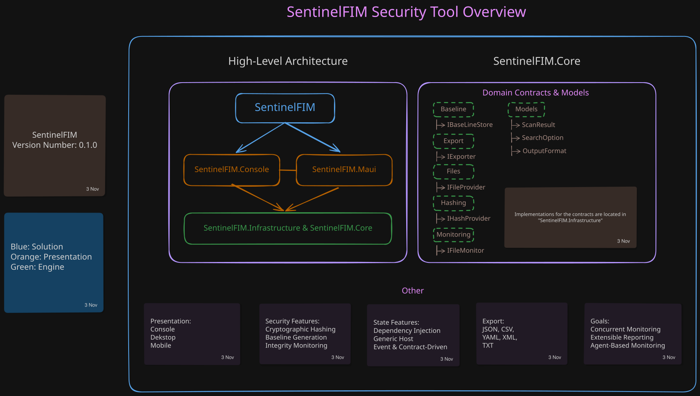

# SentinelFIM

SentinelFIM is a cross-platform File Integrity Monitoring (FIM) platform built with C# and .NET.

The project uses cryptographic hashing and real-time filesystem monitoring to detect unauthorized file modifications, deletions, and creations. SentinelFIM is designed as a security-focused application with support for reusable core services, multiple client interfaces, extensible reporting, and scalable monitoring capabilities.

## Features

### Integrity Monitoring

- SHA256 cryptographic hashing
- Baseline generation
- Baseline comparison
- File modification detection
- File creation detection
- File deletion detection
- Real-time monitoring using FileSystemWatcher

### Reporting

- Planned JSON, TXT, YAML, XML, CSV export support
- Structured monitoring output
- Extensible export architecture

### Platform Support
- Command-line interface support
- Planned desktop GUI support
- Planned mobile GUI support
- Cross-platform design

<h2>Architecture</h2>

<table>
<tr>
<td align="center">

 
<b>Core Layout</b>
</td>

<td align="center">

 
<b>Solution Architecture</b>
</td>
</tr>
</table>

<blockquote>
The editable source for the Excalidraw diagram can be found in
<code>docs/Excalidraw/SentinelFIM.excalidraw</code> and can be opened using
<a href="https://excalidraw.com/">Excalidraw</a>.
</blockquote>

<blockquote>
The editable source for the Mermaid diagram can be found in
<code>docs/Mermaid/SentinelFIMLayeredArchitecture.mmd</code> and can be opened using
<a href="https://mermaid.live/">Mermaid Live Editor</a>.
</blockquote>

SentinelFIM follows a shared, layered, contract-driven architecture that separates monitoring, hashing, reporting, and client functionality.

The monitoring engine is designed around event-driven principles, allowing multiple interfaces to consume the same core services while maintaining a consistent monitoring experience across platforms.

Current areas of focus include:

- Real-time monitoring
- Concurrent directory monitoring
- High-performance scanning
- Extensible reporting
- Cross-platform client support

## Technical Highlights

- C#
- .NET
- SHA256
- FileSystemWatcher
- Event-driven architecture
- Dependency Injection
- Concurrent processing
- Parallelized scanning
- Cross-platform application development

## Status

**Version:** 0.1.0

SentinelFIM is currently under active development as a long-term security engineering project focused on filesystem monitoring, performance, architecture, and cross-platform application design.

## License

MIT License
