# SentinelFIM

SentinelFIM is a cross-platform File Integrity Monitoring (FIM) platform built with C# and .NET that detects unauthorized file changes through cryptographic integrity verification, baseline analysis, and continuous monitoring.

By establishing a trusted baseline and validating filesystem state against that baseline, SentinelFIM can identify unexpected modifications, file deletions, and integrity violations that may indicate tampering, malware activity, configuration drift, or unauthorized system changes.

Rather than being designed as a single-purpose utility, SentinelFIM is built as an extensible monitoring platform. Monitoring, hashing, persistence, reporting, and presentation concerns are separated into independent components, allowing new capabilities to be introduced without modifying existing business logic.

---

## Features

### Integrity Monitoring

- Cryptographic file integrity verification
- Baseline generation and persistence
- Baseline comparison and validation
- File modification detection
- File deletion detection
- Continuous polling-based monitoring
- Recursive directory monitoring
- Monitoring status events and lifecycle notifications
- Cancellation-aware long-running monitoring operations

### Architecture & Extensibility

- Layered architecture
- Dependency injection throughout the application
- Provider-based hashing architecture
- Swappable monitoring implementations
- Implementation-independent monitoring abstractions
- Separation of presentation, domain, and infrastructure concerns
- Cross-platform .NET design

### Platform Support

- Command-Line Interface (CLI)
- Cross-platform architecture
- Planned desktop GUI support

---

## Architecture

<table>
<tr>
<td align="center">

 
<b>Core Layout</b>
</td>

<td align="center">

 
<b>Solution Architecture</b>
</td>
</tr>
</table>

The editable source for the Excalidraw diagram can be found in:

`docs/Excalidraw/SentinelFIM.excalidraw`

The editable source for the Mermaid diagram can be found in:

`docs/Mermaid/SentinelFIMLayeredArchitecture.mmd`

SentinelFIM follows a layered architecture that separates integrity monitoring, hashing, persistence, reporting, and presentation concerns into independent components.

The core application logic remains implementation-agnostic while infrastructure components provide monitoring, hashing, storage, and future reporting capabilities through interchangeable implementations.

This architecture enables long-term growth while maintaining clear separation of concerns and supporting future monitoring technologies, hashing algorithms, export formats, and user interfaces.

Additional architectural information can be found in:

`docs/architecture-overview.md`

---

## Current Capabilities

SentinelFIM currently supports:

- Baseline generation
- Baseline persistence and loading
- One-time integrity scans
- Continuous integrity monitoring
- Hash change detection
- File size change detection
- File deletion detection
- Recursive directory scanning
- Polling-based monitoring
- Monitoring status notifications

---

## Planned Enhancements

### Monitoring

- In-memory monitoring mode
- Event-driven monitoring implementations
- Additional monitoring providers
- Monitoring implementation factory

### Reporting

- JSON export support
- CSV export support
- XML export support
- Additional export providers

### User Experience

- Desktop GUI
- Enhanced monitoring views
- Alert management improvements

### Quality & Testing

- Automated Integration Testing
- Native AOT evaluation

---

## Technical Highlights

- C#
- .NET
- Layered Architecture
- Dependency Injection
- Cryptographic Hash Verification
- Iterator-Based Monitoring Pipelines
- Event-Driven Status Notifications
- CancellationToken Support
- Extensible Provider Model
- Cross-Platform Development

---

## Status

**Version:** 0.9.0

SentinelFIM is an actively developed security and systems engineering project focused on file integrity monitoring, tamper detection, and extensible monitoring architectures.

The current release focuses on delivering a complete command-line monitoring experience while future versions will expand monitoring capabilities, reporting options, testing coverage, and user interfaces.

---

## Development Notes

The architecture, application logic, and first-party source code for this project were designed and implemented manually.

AI was used as a learning resource for conceptual explanations, architecture discussions, debugging assistance, GitHub issue generation, and documentation support.

---

## Design Decisions

Detailed architectural decisions can be found in:

`docs/design-decisions.md`

---

## License

MIT License
