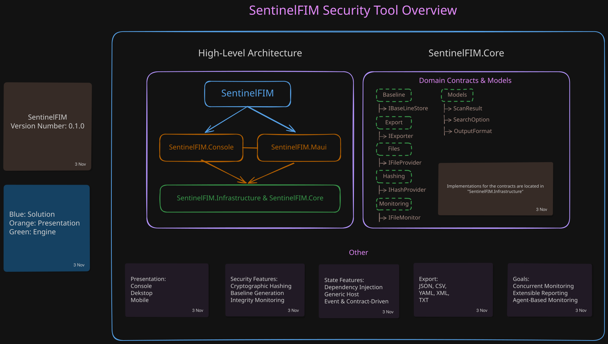

# SentinelFIM

SentinelFIM is a cross-platform File Integrity Monitoring (FIM) platform built with C# and .NET that detects unauthorized file changes through cryptographic integrity verification, baseline analysis, and continuous monitoring.

By establishing a trusted baseline and validating filesystem state against that baseline, SentinelFIM can identify unexpected modifications, file deletions, and integrity violations that may indicate tampering, malware activity, configuration drift, or unauthorized system changes.

Rather than being designed as a single-purpose utility, SentinelFIM is built as an extensible monitoring platform. Monitoring, hashing, persistence, reporting, and presentation concerns are separated into independent components, allowing new capabilities to be introduced without modifying existing business logic.

---

# Features

## Integrity Monitoring

- Cryptographic file integrity verification
- Baseline generation and persistence
- Baseline comparison and validation
- File modification detection
- File deletion detection
- Continuous polling-based monitoring
- Recursive directory monitoring
- Monitoring status events and lifecycle notifications
- Cancellation-aware long-running monitoring operations

## Baseline Management

- JSON baseline persistence
- Baseline document metadata support
- Recursive and non-recursive baseline generation
- Absolute path normalization
- Baseline loading and validation

## Architecture & Extensibility

- Layered architecture
- Dependency injection throughout the application
- Provider-based hashing architecture
- Swappable monitoring implementations
- Implementation-independent monitoring abstractions
- Separation of presentation, application, domain, and infrastructure concerns
- Cross-platform .NET architecture

## Platform Support

- Command-Line Interface (CLI)
- Cross-platform architecture
- Planned desktop GUI support

---

# Architecture

<table>

<tr>

<td align="center">



<br>

<b>Core Layout</b>

</td>

<td align="center">


<br>

<b>Solution Architecture</b>

</td>

</tr>

</table>

The editable source for the Excalidraw diagram can be found in:

```text
docs/Excalidraw/SentinelFIM.excalidraw
```

The editable source for the Mermaid diagram can be found in:

```text
docs/Mermaid/SentinelFIMLayeredArchitecture.mmd
```

SentinelFIM follows a layered architecture that separates monitoring, hashing, persistence, reporting, and presentation concerns into independent components.

The core application logic remains implementation-agnostic while infrastructure components provide monitoring, hashing, storage, and future reporting capabilities through interchangeable implementations.

This architecture enables long-term growth while maintaining clear separation of concerns and supporting future monitoring technologies, hashing algorithms, export formats, storage providers, and user interfaces.

Additional architectural information can be found in:

```text
docs/architecture-overview.md
```

---

# Current Capabilities

SentinelFIM currently supports:

- Baseline generation
- JSON baseline persistence and loading
- Baseline metadata support
- One-time integrity scans
- Continuous integrity monitoring
- Hash change detection
- File size change detection
- File deletion detection
- Recursive directory scanning
- Polling-based monitoring
- Monitoring status notifications
- Integration-tested monitoring workflows

---

# Planned Enhancements

## Cloud & Storage

- Azure Blob Storage support
- Azure-based baseline storage
- Additional persistence providers
- Encrypted baseline storage

## Monitoring

- In-memory monitoring mode
- Event-driven monitoring implementations
- Additional monitoring providers
- Monitoring implementation factory

## Reporting

- JSON report exporting
- CSV report exporting
- XML report exporting
- Extensible export provider model

## User Experience

- Desktop GUI
- Enhanced monitoring views
- Alert management improvements
- Improved configuration management

## Quality & Testing

- CI/CD pipeline
- Automated build validation
- Expanded integration test coverage
- Functional testing suite
- Native AOT evaluation

---

# Technical Highlights

- C#
- .NET
- Layered Architecture
- Dependency Injection
- Cryptographic Hash Verification
- Integration Testing
- Iterator-Based Monitoring Pipelines
- Event-Driven Status Notifications
- CancellationToken Support
- Extensible Provider Model
- Cross-Platform Development

---

# Project Highlights

- Cross-platform File Integrity Monitoring platform
- Extensible provider-based architecture
- Integration-tested monitoring workflows
- Cryptographic file verification using SHA-256
- Active development with 100+ commits approaching v1.0

---

# Status

**Version:** 0.9.0

SentinelFIM is an actively developed security and systems engineering project focused on file integrity monitoring, tamper detection, and extensible monitoring architectures.

The current release focuses on delivering a complete command-line monitoring experience while future releases will expand cloud integration, monitoring capabilities, reporting options, automated testing coverage, and user interfaces.

---

# Development Notes

The architecture, application logic, and first-party source code for this project were designed and implemented manually.

AI was used as a learning resource for conceptual explanations, architecture discussions, debugging assistance, documentation support, and technical research.

All architectural decisions, implementations, testing strategies, and final code remain developer-directed.

---

# Design Decisions

Detailed architectural decisions can be found in:

```text
docs/design-decisions.md
```

---

# License

MIT License
